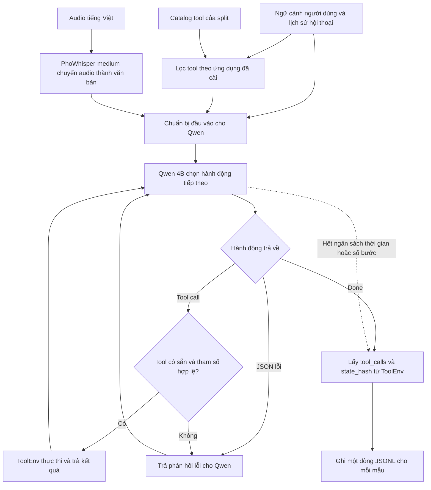

# Flow baseline LifeMate

LifeMate nhận một yêu cầu bằng giọng nói tiếng Việt và thực hiện yêu cầu qua các ứng dụng được cài đặt. Baseline dùng **PhoWhisper-medium** để chuyển audio thành văn bản và **Qwen3-4B-Instruct-2507** để chọn hành động tiếp theo. Môi trường `ToolEnv` của ban tổ chức thực thi các tool call và cung cấp trạng thái cuối để chấm.

## Cách agent xử lý một yêu cầu

1. Tạo một `ToolEnv` cho mẫu đang chạy. Chuẩn bị transcript, lịch sử, ngữ cảnh người dùng và schema của các tool khả dụng.
2. Qwen sinh một hành động JSON mỗi bước. Runner kiểm tra tên tool và dùng `env.validate()` để kiểm tra tham số trước khi gọi `env.call()`.
3. Qwen nhận kết quả hoặc lỗi để quyết định bước tiếp theo. Với câu “Bật điều hòa phòng khách 26 độ rồi đặt xe về nhà”, agent có thể tra thiết bị, dùng ID trả về để bật điều hòa, rồi dùng địa chỉ nhà trong hồ sơ để đặt xe.
4. Khi thiếu tham số bắt buộc, agent có thể gọi `sys.ask_missing_info`. Nếu yêu cầu ngoài phạm vi, agent có thể kết thúc ngay với `tool_calls: []`. Runner ghi `id`, log `tool_calls` và `state_hash` của môi trường.

## Chạy và đánh giá trên Colab

1. Chuẩn bị devkit có `train/` và `public_test/`, rồi trỏ runner tới hai checkpoint đã tải. Có thể lưu checkpoint trong `MyDrive/ZAI/models`.
2. Chạy `--replay-gold` trên 30 mẫu `train` để phát lại tool calls từ nhãn và lấy hash tham chiếu. Chạy baseline trên đúng các mẫu đó để đo tỷ lệ khớp toàn bộ chuỗi, tỷ lệ khớp hash và độ trễ. Runner theo dõi ngân sách 30 giây mỗi mẫu.
3. Chạy thêm `--train-transcripts` trên cùng các mẫu để đo ảnh hưởng của ASR. Chế độ này dùng transcript có sẵn trong `train`.
4. Chạy `--split public_test` để tạo `result/submission.jsonl`. Runner dùng audio của từng mẫu ở bước này.

## Thử nghiệm sau baseline

Nếu cần giảm thời gian chạy, thử một classifier đa nhãn chạy local để thu hẹp danh sách tool theo transcript và ngữ cảnh. Giữ baseline 4B làm mốc. Trên cùng một tập validation tách từ `train`, so sánh router + 4B với router + model nhỏ hơn bằng F1 tool calls, tỷ lệ khớp hash và độ trễ p95. Kiểm tra riêng các câu cần nhiều app hoặc nhiều bước vì router có thể lọc mất tool cần ở bước sau.
